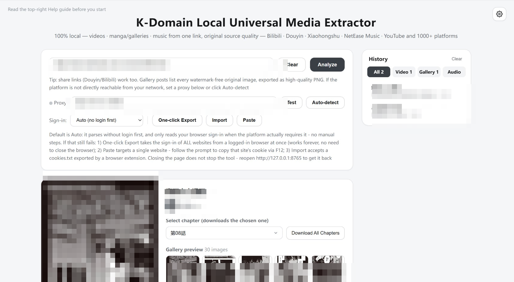

# 本地万能素材提取工具 / Local Universal Media Extractor

<p align="center">
  <b>粘贴链接 → 解析 → 选格式 → 保存到本地</b><br>
  一个完全跑在自己电脑上的素材提取工具：影视 · 漫画/图集 · 音乐，一个链接全搞定<br>
  基于 yt-dlp，支持 YouTube、TikTok、Instagram、Twitter/X、B站、抖音等上千个平台<br>
  <b>A 100% local media extractor — paste a link, save the file. Nothing ever leaves your machine.</b><br>
  Videos · manga/galleries · music from 1000+ platforms (YouTube, TikTok, X, Bilibili, Douyin…), powered by yt-dlp
</p>

<p align="center">
  Author: <b>K-Domain</b> · License: <a href="LICENSE">MIT</a>
</p>

<p align="center">
  
</p>
<p align="center"><sub>主界面 / Main interface（截图中的链接、历史记录与版权图片已模糊处理 / links, history &amp; copyrighted images masked）</sub></p>

---

## 这个工具解决什么问题 / What problem does it solve

日常想把一个链接里的视频/图片/音频存到本地时，通常会遇到这几类麻烦，本工具逐一针对性解决：

| 常见麻烦 | 本工具的解法 |
| --- | --- |
| 在线解析网站要**把链接交给第三方服务器**，隐私没保障，还塞满广告 | 完全本地运行：服务只监听 `127.0.0.1`，解析、下载、转换全部发生在你自己的电脑上，不向任何服务器上传数据 |
| 抖音 / 小红书 / 微博等平台默认**带水印**，甚至把水印**烧进视频画面** | 无水印优先：各平台走专用通道直取原件；微博的平台角标（「微博视频号 @作者」）下载后自动探测并精准修补消除 |
| 视频和音频分流、图集散落一堆随机文件名 | 自动整理：同一链接的所有产物（视频 / 封面 / 图集 / 音频）收进以内容标题命名的文件夹，文件名即标题 |
| 平台频繁改接口，工具**发布即失效** | 解析核心（yt-dlp）内置一键更新，浏览器点一下就能升级解析能力，不用重装程序 |
| 海外平台连不上，很多工具又不支持代理 | 内置代理配置、一键测试、自动探测本机常见代理端口 |
| 漫画站一章一个链接，手动保存几百张图 | 粘贴任意一话的阅读页链接 → 自动列出全部章节 → 勾选后批量下载并自动转高清 PNG、按话打包 |
| 影视站是 m3u8 分片流，浏览器原生播放器播不了 | 内置 hls.js 代理取流，m3u8 可在线预览、可下载 |

---

## 功能特性 / Features

- **四类素材**：影视视频（MP4）、漫画全话（每话一个 ZIP）、图集（多图打包 ZIP）、音乐 / 音频（原音质或 MP3）
- **粘贴即解析**：自动识别链接内容，提取标题、作者、封面、时长、观看数
- **多档分辨率**：8K / 4K / 2K / 1080P / 720P / 480P / 360P（按视频实际可用档位动态展示，并标注原视频最高画质）
- **下载前预览**：视频点封面直接播放（B站 / YouTube 等音画分离的流会自动同步声音，影视站 m3u8 分片流由内置 hls.js 经本地代理取流播放），音频一键试听，图集点击放大浏览，全部无需先下载
- **漫画站全话批量下载**：粘贴漫画库等通用漫画站任意一话的阅读页链接，自动解析全部章节列表；勾选后批量下载，页图统一转为高清 PNG（小图自动放大），每话打包为 `漫画名-话名.zip`；含解析失败自动换镜像、坏图探活、单话超时看门狗
- **音乐提取**：「原音质」不二次转码，保留 m4a / opus / flac / mp3；也可一键转通用 MP3；带歌词的音乐自动下载并写入内嵌歌词（.lrc 同步导出）
- **微博视频自动去角标**：「微博视频号 @作者」角标是平台转码时烧进画面的，本工具下载后自动多帧探测角标位置、用邻域插值精准修补并近无损重编码；探测不到角标则原样保留
- **完全本地运行**：服务只监听 `127.0.0.1`，文件只存在你的电脑上，不上传任何服务器
- **代理设置**：内置代理配置、一键测试与自动检测，海外平台解析畅通
- **默认免登录**：绝大多数平台直接解析，不需要登录、不需要配置 Cookie；只有少数需要账号的内容才会自动读取本机浏览器的登录态
- **小红书专用通道**：分享短链（xhslink.cn）与笔记链接均可解析，图文笔记导出全部原图，视频笔记直接取无水印原片（比页面播放流更清晰）
- **抖音专用通道**：分享短链（v.douyin.com）与网页链接均支持，视频 / 图集 / 音乐全部**免登录、无水印** —— 借助本机已装的 Edge/Chrome 以无痕模式在后台打开页面取数据（无窗口、无痕迹、不上传任何内容）
- **X / Twitter 免登录兜底**：X 的游客接口对部分视频报「不可用」时自动改用公开镜像直链解析与下载，不再误报「要求登录」
- **微信视频号通道**：粘贴 `weixin.qq.com/sph/xxx` 分享链接即可。视频号不对外提供直链，工具改走腾讯元宝解析接口换 exportId/token，再调视频号 feed 接口取直链；需要**一次性**配置元宝登录态（浏览器登录 yuanbao.tencent.com 后点面板里的 Edge/Chrome 按钮自动读取，或手动粘贴 Cookie），存在程序目录 `wechat_yuanbao_cookie.txt`，不会上传
- **实时进度**：下载速度、剩余时间、图片张数、转换与封装状态一目了然；批量下载按钮有「下载中 / 已完成」状态
- **中英双语**：右上角一键切换中文 / English
- **内置说明面板**：右上角「?」按钮集中说明支持平台、使用步骤、注意事项、Cookie 与隐私、合规提醒
- **自动整理**：同一链接的文件自动收进以标题命名的文件夹（封面 / 视频 / 音频 / 图集同处）

## 支持的素材与平台 / Supported Media & Platforms

基于 [yt-dlp](https://github.com/yt-dlp/yt-dlp) 引擎，官方支持 **上千个平台**，包括但不限于：

YouTube · TikTok · Instagram · Twitter/X · Facebook · Bilibili · 抖音 · 西瓜视频 · 微博 · 小红书（图文 / 视频笔记）· Vimeo · Twitch · Dailymotion · SoundCloud · …

完整列表见 [yt-dlp supported sites](https://github.com/yt-dlp/yt-dlp/blob/master/supportedsites.md)。

| 素材类型 | 说明 |
| --- | --- |
| 视频 | 输出 MP4；高清档位为画面 + 音频分流，工具自动合并；微博视频自动消除平台角标 |
| 图集 | 输出原图并统一转为高清 PNG，**小图自动放大**（低分辨率图放大后落盘，封面同样生效）；多张自动打包为 ZIP，单张直接下载 |
| 漫画 | 通用漫画站（页面结构相似即可）：整话页图统一转 PNG（**小图自动放大**），每话打包 `漫画名-话名.zip`，支持全话批量 |
| 影视站（m3u8 分片流） | 内置 hls.js 在线预览 + 本地代理下载合成 |
| 音乐 / 音频 | 原音质保留原始编码，或转 MP3 192kbps；歌词自动内嵌并导出 .lrc |

**已知不支持**：DRM 加密内容（Netflix / Disney+ / Prime Video 等），付费课程与会员专属内容，私密直播间，评论区图片。微信视频号需按上文说明一次性配置元宝登录态后方可使用。页面右上角「?」按钮内有完整说明。

### 去水印策略 / Watermark-free policy

所有平台解析出的视频与图片一律**优先取无水印原件**：

- **小红书**：图文取 `ci.xiaohongshu.com` 原图；视频取 `originVideoKey` 对应的 CDN 原片（无水印、比页面播放流分辨率更高），原片不可用时才回退
- **抖音**：走本机浏览器通道，取 `aweme_detail` 里的无水印直链（页面转码流带「@作者 + 抖音」水印，不使用）
- **X / Twitter**：图片强制 `name=orig` 上传原图
- **微博**：图床地址统一改写为 `/large/` 原图；视频的平台角标（烧录在画面右上角）下载后自动探测并用邻域插值修补消除
- **B站 / 字节系**：去掉 CDN 缩放 / 处理模板参数
- **下载阶段**：格式选择器会跳过带水印标记（`watermark` / `download_addr` 等）的流

若某个平台对某条内容只提供带水印的文件（水印已烧录进画面），任何工具都无法去除。

## 快速开始 / Quick Start

### 前置条件 / Requirements

**运行环境 / Environment**

| 项目 | 要求 |
| --- | --- |
| 操作系统 | Windows 10/11、macOS 12+、主流 Linux 发行版（64 位） |
| Python | **3.9+**（[下载地址](https://www.python.org/downloads/)；用现成 exe 则不需要） |
| 内存 / 磁盘 | 常规配置即可；留出下载文件所需的磁盘空间 |
| 浏览器 | 任意现代浏览器（Chrome / Edge / Firefox / Safari）；**抖音通道**额外要求本机装有 Edge 或 Chrome |
| 网络 | 首次启动需联网**自动安装依赖**（Flask / yt-dlp / ffmpeg）；解析和下载本身也需要联网。海外平台（YouTube / TikTok / Instagram 等）在中国大陆需要自行配置代理 |
| 端口 | 本地端口 **8765** 必须空闲（被占用时启动会报错，可用环境变量 `PORT` 换端口） |

**使用须知 / Important**

- 这是一个**本地程序**：启动后会有一个控制台窗口（黑窗口），它就是服务本体，**使用期间不要关闭**，关了页面就会显示「无法连接本机服务」。
- Windows 安装 Python 时请勾选 **Add python.exe to PATH**。
- 没装 Python 也可以：在项目根目录建一个 `python_path.txt`，写一行便携版 `python.exe` 的完整路径，启动脚本会自动用它。
- 首次启动会自动安装依赖（国内 PyPI 直连失败会自动换清华镜像重试），之后秒开。
- 部分杀毒软件可能对下载行为或 PyInstaller 打包的 exe 报警，属于常见误报，代码全部开源可自行核对。
- 每个链接的文件会自动归到一个以**内容标题命名**的子文件夹里（封面、视频、音频、图集都在同一个文件夹），不再散落成一堆随机名目录。

### 方式零 / Option 0：现成可执行文件（不用装 Python）

到 [Releases](https://github.com/KDomainLab02/UniversalMediaExtractor/releases) 下载对应系统的 **zip 包**，解压后直接双击里面那个文件：

| 系统 | 下载的包 | 解压后得到 | 说明 |
| --- | --- | --- | --- |
| Windows 10/11 | `UniversalMediaExtractor-windows.zip` | `UniversalMediaExtractor.exe` | 双击即用，约 60 MB 单文件 |
| macOS | `UniversalMediaExtractor-macos.zip` | `UniversalMediaExtractor.app` | 首次打开需**右键 → 打开**（未做 Apple 签名，系统会拦一次） |
| Linux | `UniversalMediaExtractor-linux.zip` | `UniversalMediaExtractor` | 先 `chmod +x`，再双击或终端运行 |

几点要知道：

- **第一次启动约 3 秒**，之后同样（单文件版每次启动都要解压到临时目录）。
- 部分杀毒软件会对 PyInstaller 打包的程序报「未知程序」，这是打包工具的常见误报，代码全部开源可自行核对，也可以直接自己从源码打包。
- 所有数据都放在**程序所在目录**：`downloads/`（下载文件）、`download_dir.txt`（你选的下载地址）、`cookies_*.txt`。把 exe 单独拷到别的文件夹，等于开了一个干净的实例。
- 想移到桌面用，建议建快捷方式，不要直接把 exe 拖到桌面后再删原目录——配置会跟着新目录走。

### 自己打包 / Build from source

```bash
pip install -r requirements.txt
python build_exe.py            # 单文件，产物在 dist/
python build_exe.py --onedir   # 文件夹版，启动更快
```

PyInstaller **不能跨系统打包**：Windows 的 exe 只能在 Windows 上生成，macOS 的 .app 只能在 macOS 上生成。仓库里的 `.github/workflows/build.yml` 已经配好三平台自动构建——推一个 `v*` 标签，GitHub 就会把三个系统的产物都打好并附到 Release 上。

### 方式一：双击启动（Windows）

下载或克隆本项目后，直接双击 **`start.bat`**：

```
start.bat            ← 双击这个
```

第一次会弹出一个窗口自动安装依赖，装完浏览器会自动打开 `http://127.0.0.1:8765`。
**使用期间不要关闭这个窗口**，关掉它服务就停止，重新双击即可恢复。

### 方式二：双击启动（macOS）

双击 **`start.command`**（首次可能需要在「系统设置 → 隐私与安全性」里允许运行）。
若提示没有执行权限，在终端执行一次：

```bash
chmod +x start.command
```

### 方式三：命令行（全平台通用）

```bash
# 1. 获取代码（或直接下载 ZIP 解压）
git clone https://github.com/KDomainLab02/UniversalMediaExtractor.git
cd UniversalMediaExtractor

# 2. 启动（launcher 会检查 Python 版本并自动安装依赖）
python launcher.py        # Windows 也可能要用 py -3 launcher.py
python3 launcher.py       # macOS / Linux
```

也可以用最直接的方式，跳过依赖自检：

```bash
pip install -r requirements.txt
python app.py
```

打开浏览器访问 **http://127.0.0.1:8765** 即可使用。

### 改代码时用开发模式 / Dev mode

边改边测就双击 **`dev.bat`**（macOS/Linux 用 `python launcher.py --dev`）。它会监视 `app.py` 和 `templates/index.html`，**改完保存自动重启**，你只需要刷新浏览器，不用每次关窗重开。普通 `start.bat` 不会自动重启。

### 保持解析能力：更新解析核心 / Keep the parser up to date

视频平台经常改接口， yt-dlp 跟不上就会解析失败。**右上角菜单 → 「解析核心 → 检查更新」**会从 PyPI 下载最新版到程序目录的 `core/`，**重启程序后生效**（关闭黑窗口再重新打开）。打包版（exe / .app / AppImage）里没有 pip，全靠这个按钮升级；源码运行的用户也可以照旧 `pip install -U yt-dlp`。

> 这是一个本地程序：关掉命令行窗口服务就停止，重新运行即可恢复，已下载的文件不会丢失（在下载地址里按标题分文件夹存放）。

### 平台兼容性 / Platform notes

| 系统 | 启动方式 | 文件夹选择框 |
| --- | --- | --- |
| Windows 10 / 11 | `start.bat` | 系统原生资源管理器样式（IFileOpenDialog） |
| macOS 10.13+ | `start.command` | 系统原生 `choose folder` 面板 |
| Linux（GNOME / KDE） | `python3 launcher.py` | `zenity` / `kdialog`，都没有则退回 Tk |

只要有 Python 3.9+，三种系统都能跑；其余差异只体现在「选择新地址」用的原生对话框上。


## 使用说明 / Usage

1. **粘贴链接**（视频 / 图集 / 音乐 / 漫画 / 影视都行），点击「开始解析」
2. 工具自动判断素材类型：
   - **视频** → 选择分辨率，点「下载视频」；或点「提取音频」导出 MP3
   - **图集** → 预览全部缩略图，点「打包下载全部图片」得到 ZIP
   - **漫画站** → 自动列出全部章节，勾选要下载的话（或全选），点「下载全话」；每话打包为 ZIP，页图统一转 PNG
   - **影视（m3u8）** → 在线预览确认内容，点下载由本地代理取流合成
   - **音乐** → 点「下载音乐」，可选原音质或转 MP3
3. 下载完成后点「保存到本地」（默认已存到所选下载地址，按标题分文件夹）

### 代理设置 / Proxy

如果目标平台在你的网络中无法直接访问，需要配置代理：

- **自动检测（推荐）**：点击「自动检测」按钮，工具会并行探测本机常见代理端口（Clash 系 7897/7890、v2rayN 10809 等）并自动填入，检测成功会显示绿色状态点
- **手动填写**：填入代理软件的本地 HTTP 端口地址，如 Clash Verge 默认 `http://127.0.0.1:7897`（端口可在代理软件的设置页面查看），点击「测试」验证连通性

### 登录态 / Sign-in

**默认不需要登录**：工具先免登录直解，绝大多数平台（B站、抖音、小红书、微博、SoundCloud…）都能直接拿到内容。

只有当平台确实要求账号时（部分 YouTube 视频、私密或限流内容、B站高码率），工具才会自动按「已导出的 Cookie 文件 → 本机浏览器登录态」顺序尝试，成功后会提示实际用了哪份登录态。若自动仍失败：

1. 下拉框手动指定一个你**已登录该平台**的浏览器（Edge / Chrome / Firefox）
2. 或点「一键导出」：自动关闭浏览器 → 导出 Cookie → 自动重启并恢复标签页，之后永久生效
3. 若提示无法解密（App-Bound 加密），用扩展「Get cookies.txt LOCALLY」导出 txt 后点「导入」，或改用 Firefox

## 输入输出示例 / Input & Output Examples

以下示例中的链接、标题均为**虚构示意**，仅用于说明输入输出形态；实际文件名以内容真实标题为准。

### 示例 1：视频帖（X / B站 / YouTube 等）

**输入**（粘贴到输入框 → 开始解析 → 选 1080P → 下载视频）：

```
https://<平台域名>/<视频路径>/<视频ID>
```

**输出**（默认在程序目录的 `downloads/`，可在页面里改下载地址）：

```
下载目录/
└─ 示例视频标题/                  ← 以内容标题命名的文件夹
   ├─ 示例视频标题.mp4            ← 所选分辨率 MP4，音画自动合并
   └─ 示例视频标题_封面.jpg       ← 封面
```

### 示例 2：图集帖（小红书 / X 等）

**输入**：

```
https://<平台域名>/<笔记路径>?xsec_token=...
```

**输出**：全部原图导出为高清 PNG（小图自动放大），按三位序号命名：

```
下载目录/
└─ 示例笔记标题/
   ├─ 示例笔记标题_001.png
   ├─ 示例笔记标题_002.png
   ├─ 示例笔记标题_003.png
   └─ 示例笔记标题_004.png
```

### 示例 3：漫画站全话批量下载

**输入**（通用漫画站的任意一话阅读页）：

```
https://<漫画站域名>/comic/<漫画ID>/<章节ID>.html
```

**处理**：自动解析出全部章节列表 → 勾选范围（或全选）→ 批量下载 → 每话页图统一转高清 PNG（小图自动放大）→ 打包。

**输出**（每话一个 ZIP，散图不出现在磁盘上）：

```
下载目录/
└─ 示例漫画名/
   ├─ 示例漫画名-第12话.zip
   ├─ 示例漫画名-第11话.zip
   └─ …
```

界面会显示「成功 X 话 / 共 Y 话，跳过 Z 话，失败 N 话」，失败的话会列出标题方便重试。

### 示例 4：音乐 + 歌词

**输入**：音乐平台的歌曲链接 → 点「下载音乐」。

**输出**：

```
下载目录/
└─ 示例歌曲名/
   ├─ 示例歌曲名.mp3            ← 或原音质 .m4a / .opus / .flac（不转码）
   └─ 示例歌曲名.lrc            ← 歌词（mp3 会同时内嵌歌词）
```

### 示例 5：微博视频（自动去平台角标）

**输入**：

```
https://<微博域名>/show?fid=1034:<视频ID>
```

**处理**：下载原片 → 自动探测右上角「微博视频号 @作者」角标 → 邻域插值修补 → CRF 18 近无损重编码（进度条 90→99 为修补阶段）。

**输出**：

```
下载目录/
└─ 示例微博视频/
   └─ 示例微博视频.mp4          ← 角标已消除；探测不到角标的视频则原样保留
```

> 说明：如果水印是**博主自己剪辑进画面**的内容（不是平台叠加的角标），属于画面内容本身，任何工具都无法去除。

## 开发与自检 / Development & Self-check

改漫画解析相关代码后，先跑离线自检（不联网，秒级）：

```bash
python tests/test_manga_parse.py
```

覆盖的历史坑（每条都对应一次线上故障）：

- 漫画图片地址由页面 JS 拼接表达式生成，`('' || '目录名')` 这类空默认段必须按 JS 真值语义求值，否则整话图片 URL 变成 `...//1.webp` 全 404
- 解析出的图片地址先做**结构校验**（空段 / 空格 / 无扩展名），再**首图探活**（Range 取 2KB 验图片魔数）；不达标宁可明确报错，也不把坏地址交给下载队列
- 图片路径含中文（如 `1.姐姐1`）时，HTTP 请求行必须是百分号转义后的 ASCII，否则整话下载全部失败
- 漫画标题里带「第七節」「序章」等字样的详情页自链，不能当成章节页

## 常见问题 / FAQ

| 问题 | 解决方案 |
| --- | --- |
| YouTube 提示登录验证 | 选择已登录的浏览器 Cookie（见上文） |
| 代理测试失败 | 确认代理软件已开启、端口正确 |
| B站/抖音高清无法下载 | 部分高清档位需要登录，同样可通过浏览器 Cookie 解决 |
| 图集显示「未找到图片」 | 该链接实际是视频，或图集需要登录（私密帖），配好 Cookie 再试 |
| 图片预览空白但能下载 | 平台限制外链预览，不影响打包下载 |
| 某链接解析失败 | 平台改版导致：菜单里「解析核心 → 检查更新」下载最新 yt-dlp 后重启程序；源码运行也可以 `pip install -U yt-dlp` |
| 页面提示「无法连接本机服务」 | 服务没在运行：重新运行 `start.bat`，**不要关那个控制台窗口**；或端口 8765 被占用，换端口启动（`PORT=8888 python app.py`）。开发模式（dev.bat）改代码会自动重启服务，几秒内的请求会自动重试，无需手动刷新 |
| 双击 start.bat 后窗口一闪而过 / 只显示 Press any key | 机器上没有可用的 Python（Windows 商店的 python 占位符不算）。装 Python 并勾选 Add to PATH，或按上文建 `python_path.txt` |

## 免责声明 / Disclaimer

本项目仅供个人学习与研究使用。使用本工具下载内容时，请尊重内容创作者的版权以及各平台的服务条款，**严禁用于任何商业用途或侵权行为**。因使用本工具产生的任何问题由使用者自行承担。

This project is for personal learning and research only. Please respect the copyrights of content creators and the terms of service of each platform. Any issues arising from the use of this tool shall be borne by the user.

## License

[MIT](LICENSE) © 2026 [K-Domain](https://github.com/KDomainLab02)

## Third-party Components / 第三方组件

完整声明（版权、许可证全文、源码链接、GPL 合规说明）见 [THIRD-PARTY-NOTICES.md](THIRD-PARTY-NOTICES.md)。
For the complete legal notices, see [THIRD-PARTY-NOTICES.md](THIRD-PARTY-NOTICES.md).

**仓库源码内嵌 / Bundled in the repository:**

- [hls.js](https://github.com/video-dev/hls.js) v1.5.20 — HLS 流浏览器预览（`assets/hls.light.min.js`）。License: Apache-2.0

**运行时依赖 / Runtime dependencies (via `requirements.txt`):**

- [yt-dlp](https://github.com/yt-dlp/yt-dlp) — 解析核心 / extraction engine. License: Unlicense（公有领域 / public domain）
- [Flask](https://github.com/pallets/flask) — Web 服务. License: BSD-3-Clause
- [imageio-ffmpeg](https://github.com/imageio/imageio-ffmpeg) — 提供 ffmpeg 二进制（该二进制为 **GPL v3** 构建）. License: BSD-2-Clause
- [websocket-client](https://github.com/websocket-client/websocket-client) — License: Apache-2.0
- [Pillow](https://github.com/python-pillow/Pillow) — 图像处理. License: MIT-CMU
- [mutagen](https://github.com/quodlibet/mutagen) — mp3 歌词写入. License: GPL-2.0-or-later

本项目自身代码以 MIT 发布，与上述组件的许可证相互独立；各组件保持其原始许可证。
This project's own code is MIT-licensed, independent of the components above, which retain their original licenses.
